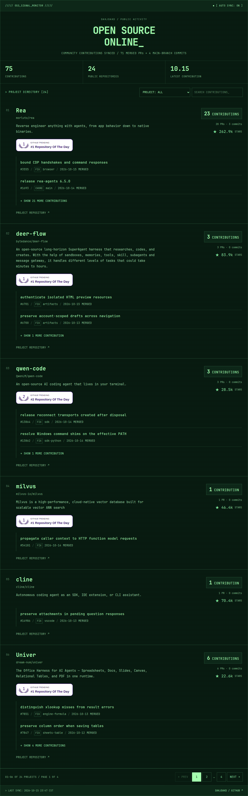

<h1>👋😊 I'm Lucien </h1>

<strong>AI Builder</strong> · LLM Applications · Agent Workflow · RAG

Turning AI capabilities into useful, demonstrable products.

---

<h2 align="center">🧭 About Me</h2>

  I am an Artificial Intelligence undergraduate and AI Builder focused on turning 
  LLM capabilities into useful, demonstrable products.

  I connect AI engineering, product thinking, visual expression, and content creation 
  into a complete build-and-share loop.

  LLM applications &nbsp;·&nbsp; Agent workflow &nbsp;·&nbsp; RAG &nbsp;·&nbsp; Context engineering &nbsp;·&nbsp; AI-native products

<h2 align="center">⌁ Open Source Contributions</h2>

  

  <a href="https://dakjdakd.github.io/dakjdakd/"><strong>Browse all projects · Filter · Search · Previous / Next →</strong></a>

